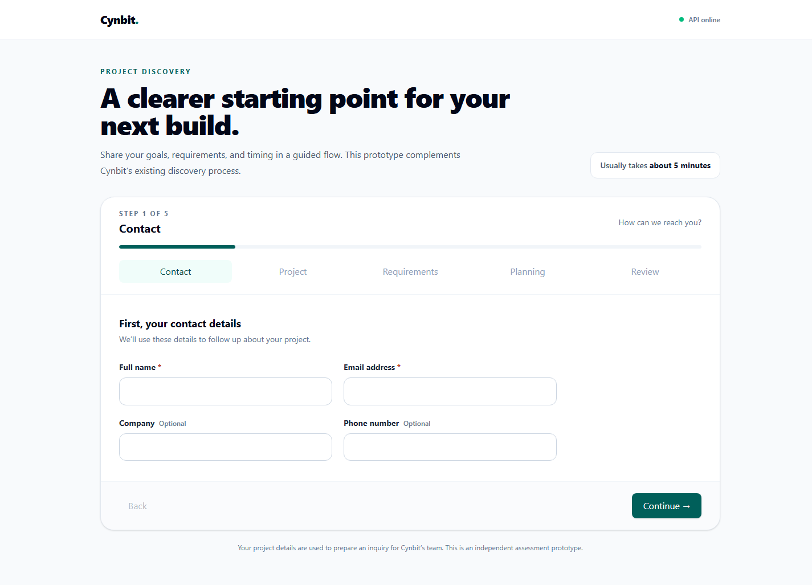
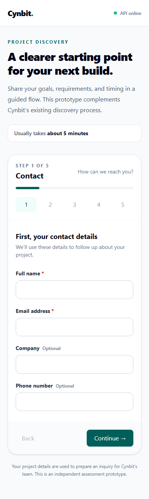
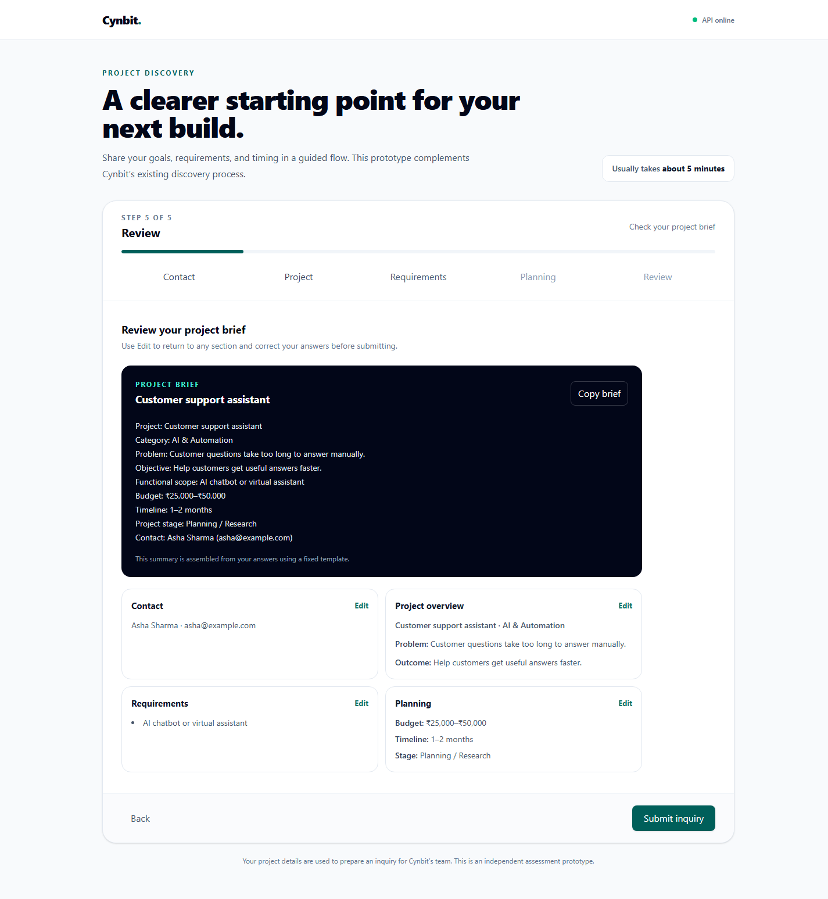
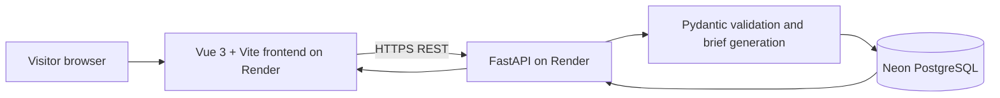

# Cynbit Project Discovery & Scoping Assistant

An independent website-improvement prototype for a guided project inquiry. It is designed to complement Cynbit's existing discovery process by helping prospective clients describe their project goals, requirements, and planning expectations in a structured way.

## Current progress

The five-step Vue workflow, dynamic requirement choices, editable review, deterministic brief preview, FastAPI validation, idempotent inquiry endpoint, and PostgreSQL persistence are implemented. The frontend production build and local inquiry submission have been verified. The app is deployed publicly on Render and connected to Neon.

## Problem and solution

Cynbit's public Contact page collects contact details, company, industry, and a free-text message. The independent prototype adds a guided way for prospective clients to describe project scope, required functionality, budget, and timeline before submitting an inquiry. It complements the existing contact experience and does not modify Cynbit's production site.

## Key features

- Five-step inquiry flow with step validation, back navigation, and editable review.
- Six project categories with category-specific requirement options.
- Deterministic project brief preview; no external LLM dependency.
- FastAPI validation and PostgreSQL persistence with idempotency-key duplicate protection.
- Loading, API status, submission error, and success states.

## Live demo

- Frontend: <https://cynbit-project-discovery-assistant-hz5m.onrender.com>
- API health: <https://cynbit-project-discovery-assistant.onrender.com/api/health>

## Screenshots

Captured from the deployed app with synthetic example details.







## Repository layout

```text
frontend/            Vue 3 + Vite application
backend/app/         FastAPI application
backend/tests/       Backend validation and persistence tests
docs/                Technical report and deployed UI screenshots
backend/requirements.txt
backend/requirements-dev.txt
```

The API uses PostgreSQL with structured inquiry columns and a JSONB requirements list. Its table is created on the first successful submission. Repeating a request with the same `Idempotency-Key` returns the original saved inquiry.

## Architecture



The inquiry table stores contact and project fields, a generated brief, a unique idempotency key, and a timestamp. Requirements are stored as JSONB. The table is created on the first successful submission; database migrations are not configured.

## API

- `GET /api/health` — API liveness check.
- `POST /api/inquiries` — validates an inquiry, generates a rule-based brief, and stores it in PostgreSQL.

The submit endpoint requires an `Idempotency-Key` UUID header. The frontend creates and reuses this key for retries in the current browser session.

## Local setup

Use Python 3.11 or later and Node.js 22.12 or later.

### Backend

From the repository root:

```powershell
cd backend
python -m venv .venv
.\.venv\Scripts\Activate.ps1
pip install -r requirements.txt
notepad .env
# Add DATABASE_URL=<your PostgreSQL/Neon connection string>, then save and close Notepad.
uvicorn app.main:app --reload --env-file .env
```

The API health endpoint is `http://127.0.0.1:8000/api/health`. The real Neon connection string belongs in the ignored `backend/.env` file locally; never commit it.

### Frontend

In a second terminal, from the repository root:

```powershell
cd frontend
npm install
npm run dev
```

The frontend uses `http://localhost:8000` by default. To change it, create `frontend/.env.local` with `VITE_API_BASE_URL` set to the API base URL.

### Backend checks

From the repository root, install development dependencies and run the automated backend tests:

```powershell
cd backend
pip install -r requirements-dev.txt
python -m pytest -q
```

The test suite covers Pydantic validation, category-specific requirements, deterministic brief content, database URL handling, and idempotent save behavior using a mocked connection. The current result is **11 passed**.

## Environment variables

Backend deployment placeholders are listed in `.env.example`; frontend configuration is in `frontend/.env.example`. Keep real credentials in local environment variables or the hosting provider's secret settings. Do not commit `.env` files.

## Deploy with Render

The root `render.yaml` Blueprint defines a Python API service and a static Vue frontend. The current deployment is:

- Frontend: <https://cynbit-project-discovery-assistant-hz5m.onrender.com>
- API: <https://cynbit-project-discovery-assistant.onrender.com>

To recreate the deployment:

1. Push the repository to GitHub and connect it to Render.
2. In the Render Dashboard, create a new Blueprint and select this repository's `main` branch.
3. When prompted, provide `DATABASE_URL` from the local `backend/.env` file as a secret. Never add the connection string to Git.
4. Deploy both services and wait for their health/build checks to pass.

The API is configured in the Ohio region to stay near the Neon database's US East region. The frontend is served from Render's global static-site CDN. The free API service can spin down when idle; its first request afterward may take about a minute.

## Verification status

Verified: frontend production build; five-step wizard validation, category changes, back navigation, and review editing; local inquiry submission; public five-step browser submission and success screen; public API health; CORS preflight from the deployed frontend; idempotent API submission backed by a confirmed PostgreSQL row; and 11 passing backend tests.

The [technical report](docs/technical-report.md) documents the problem, design, architecture, data model, verification, deployment, and limitations.

## Known limitations

- The free Render API instance spins down when idle, so its first request afterward can be delayed.
- There is no authentication or administrative inquiry dashboard.
- There is no migration framework or usability-study data. Business impact has not been measured.
