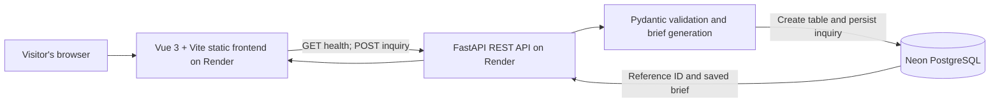

# Technical Report: Cynbit Project Discovery & Scoping Assistant

**Assessment:** Full Stack Developer Intern — Improve Cynbit's Website

**Project:** Independent project discovery prototype
**Status:** Deployed prototype; technical verification completed as described below

## 1. Problem and scope

Cynbit Technologies offers a diverse range of services, including AI automation, custom software development, cloud infrastructure, and digital solutions.

Its existing Contact page provides an inquiry form that collects contact details, company, industry, and a free-text message. While this allows visitors to initiate conversations, it does not provide a structured way to communicate project scope, required functionality, budget expectations, or delivery timelines.

As a result, prospective clients may need to describe their requirements without guidance, making the initial inquiry less structured.

This assessment project is an independent prototype based on the publicly visible Cynbit site. It complements the existing contact experience; it does not replace or modify Cynbit's production website. The public contact form and services page were reviewed on October 31, 2026: [Cynbit Contact](https://www.cynbit.in/contact) and [Cynbit Services](https://www.cynbit.in/services).

## 2. Proposed solution

The Cynbit Project Discovery & Scoping Assistant introduces a guided, five-step inquiry workflow. It collects project-specific information through dynamic requirement checklists, captures budget and timeline expectations, and generates a structured project brief before submission.

The solution aims to make project inquiries more informative, improve requirement clarity, and provide a more organized starting point for client discussions. These are design goals; no conversion, revenue, lead-quality, or sales-effort outcomes have been measured.

## 3. User workflow and features

1. **Contact:** name and email are required; company and phone are optional.
2. **Project overview:** select one of six service categories, then describe the problem and desired outcome.
3. **Requirements:** choose capabilities tailored to the selected category or enter another requirement.
4. **Planning:** select a budget range, timeline, and current project stage.
5. **Review and submit:** review the answers, edit an earlier section, copy the deterministic project brief, and submit the inquiry.

The UI validates each step before advancing, retains answers during back navigation, and clears selected requirements when the category changes. The API independently validates the request using Pydantic.

## 4. Architecture

The frontend sends inquiries over HTTPS to the API. The API validates the submitted fields, creates a rule-based brief, and saves structured columns plus a JSONB requirements list to PostgreSQL. An `Idempotency-Key` UUID prevents a retried request from creating a duplicate row.

## 5. Technology choices

| Layer | Choice | Reason |
|---|---|---|
| Frontend | Vue 3, JavaScript, Vite | Lightweight component-based wizard and production bundling |
| Styling | Tailwind CSS | Responsive layout and consistent utility styling |
| Backend | Python, FastAPI | Typed REST API with generated API documentation |
| Validation | Pydantic | Server-side validation of fields and allowed choices |
| Database | PostgreSQL on Neon | Persistent relational storage with JSONB for selected requirements |
| Hosting | Render static site and web service | Public frontend and API deployment from the GitHub repository |

No external LLM is used. The brief is created by a deterministic template so it works without paid model credentials or quotas.

## 6. Data model and API

The `inquiries` table stores a UUID, unique idempotency key, contact fields, project category and title, problem and objective text, selected requirements, planning choices, generated brief, and creation timestamp. The table is created on the first successful submission. The project currently has no migration framework.

- `GET /api/health` returns API liveness status.
- `POST /api/inquiries` validates and stores an inquiry; it requires the `Idempotency-Key` header and returns a reference ID, timestamp, and saved brief.

Database credentials are configured as environment variables. The local connection string belongs in the ignored `backend/.env`; the deployed service uses Render's secret environment setting. No credential is included in this report.

## 7. Verification performed

| Check | Result |
|---|---|
| Frontend production build (`npm run build`) | Passed |
| Five-step validation, category changes, back navigation, and review edits | Wizard logic checks passed; user also confirmed local form submission works |
| Local API health | Returned `ok` |
| Local database save | Synthetic inquiry saved and confirmed in Neon |
| Public frontend | Returned HTTP 200 |
| Public API health | Returned `ok` |
| Public CORS preflight from the deployed frontend origin | Returned HTTP 200 with the expected allowed origin |
| Public API inquiry persistence | Returned the saved reference; the corresponding PostgreSQL row was confirmed |
| Duplicate retry | Reused the same idempotency key and returned the existing reference without inserting another row |
| Backend automated tests (`python -m pytest -q`) | 11 passed |
| Public browser workflow | Completed all five steps, changed category, edited the review, submitted, and saw the success screen; the returned reference matched the saved PostgreSQL row |
| Public UI screenshots | Captured desktop Contact, mobile Contact, and desktop Review screens with synthetic details; included in `docs/screenshots/` |

The public workflow was exercised in a headless Chrome session with synthetic test details. The owner also manually submitted the local form. No usability study, Lighthouse run, or business-impact measurement was performed.

## 8. Deployment and limitations

- Live frontend: [cynbit-project-discovery-assistant-hz5m.onrender.com](https://cynbit-project-discovery-assistant-hz5m.onrender.com)
- API health: [cynbit-project-discovery-assistant.onrender.com/api/health](https://cynbit-project-discovery-assistant.onrender.com/api/health)
- The FastAPI service is on Render's free plan in Ohio; the static frontend is served globally. Render displays a warning that the free API instance spins down when idle and can delay a request by 50 seconds or more.
- This prototype has no authentication or administrative inquiry dashboard. It is not integrated with Cynbit's internal systems.
- The database table is created on demand; schema changes are not managed by migrations.

## 9. Future improvements

- Add database migrations before extending the schema.
- Add a secure, authenticated inquiry-management view only if it becomes a confirmed product need.
- Evaluate usability with real participants before drawing conclusions about comprehension or business outcomes.
